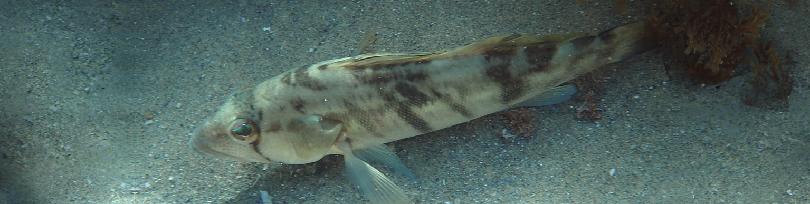

&nbsp;


<style>
  .col2 {
    columns: 2 200px;         /* number of columns and width in pixels*/
    -webkit-columns: 2 200px; /* chrome, safari */
    -moz-columns: 2 200px;    /* firefox */
  }
  .col3 {
    columns: 3 100px;
    -webkit-columns: 3 100px;
    -moz-columns: 3 100px;
  }
  .col4 {
    columns: 4 100px;
    -webkit-columns: 4 100px;
    -moz-columns: 4 100px;
  }
</style>

<style type="text/css">

body{ /* Normal  */
   font-size: 13px;
}
td {  /* Table  */
   font-size: 12px;
}
h1 { /* Header 1 */
 font-size: 18px;
 color: DarkBlue;
}
h2 { /* Header 2 */
 font-size: 15px;
 color: DarkBlue;
}
h3 { /* Header 3 */
 font-size: 14px;
 color: DarkBlue;
}
code.r{ /* Code block */
  font-size: 11px;
}
pre { /* Code block */
  font-size: 11px
}
</style>


***



***

&nbsp;


***

```{r setup, include=FALSE}
library(openMSE)
library(dplyr)
library(kableExtra)
library(readxl)
library(mahiMSE)

knitr::opts_chunk$set(echo = FALSE)

maketab <- function(dir,Alab="Statistical Area"){
  filenam = list.files(dir)
  nf = length(filenam)
  DF = data.frame(filenam)
  names(DF) = c("Area")
  #filepath = list.files(dir, full.names = T, include.dirs = T)
  fit.link = paste0('<a href=', file.path(dir, filenam), '> ', DF$Area , ' </a>')
  DF$Area <- fit.link
  DT::datatable(DF, escape=1,
                colnames=c(Alab),
                filter = 'top',
                options = list(
                  pageLength = 10, 
                  autoWidth = TRUE,
                  sDom  = '<"top">lrt<"bottom">ip'))
}


plotatab <- function(filey,sheet,head=T){
  if(head){
    dat = read_xlsx(paste0(getwd(),"/",filey),sheet)
    kable(dat,"simple") 
  }else{
    dat = read_xlsx(paste0(getwd(),"/",filey),sheet,col_names=F)
    kable(dat,"simple",col.names=rep("",ncol(dat))) 
  }
}


getprojectinfo<-function(page){
  tab=as.data.frame(read_excel("project_Info/Status Assumptions To do.xlsx", sheet = page))
  tab=tab[,2:3]
  tab[is.na(tab)]=""
  kable(tab,"simple")#,col.names=rep("",2)) 
}
  

getprog<-function(page){
  tab=as.data.frame(read_excel("Project_Info/Progress.xlsx", sheet = page))
  tab=tab[,2:3]
  tab[is.na(tab)]=""
  kable(tab,"simple")#,col.names=rep("",2)) 
}
 
datadir = "G:/Shared drives/BM shared/1. Projects/CDFW_BSB/Data"
PC = readRDS(paste0(datadir,"/Processed/PC.rds"))
PR = readRDS(paste0(datadir,"/Processed/PR.rds"))
LB = readRDS(paste0(datadir,"/Processed/LB.rds"))
miceadds::source.all("C:/GitHub/BSBMSE/R")

fits = readRDS("C:/GitHub/BSBMSE/Objects/Fits/fits.rds")

PC_LNV = fits$PC_LNV; PC_LNVS = fits$PC_LNVS; PC_LNVSI = fits$PC_LNVSI
PR_LNV = fits$PR_LNV; PR_LNVS = fits$PR_LNVS; PR_LNVSI = fits$PR_LNVSI
LB_LNV = fits$LB_LNV; LB_LNVS = fits$LB_LNVS; LB_LNVSI = fits$LB_LNVSI

proj = readRDS("C:/temp/BSB/proj.rds")
projBL = readRDS("C:/temp/BSB/projBL.rds")

```


# Disclaimer

The following work is preliminary and intended only as tool for eliciting feedback on data, modelling and other aspects of this fishery. 

None of these results are final. 

These analyses do not necessarily reflect the point of view of CDFW and in no way anticipate CDFW future policy.

***

# Objective

Develop an MSE framework for the California Barred Sand Bass fishery to test candidate management procedures including size limits and bag limits.  

***

# Project details

Title: 'Quantitative tools in support of California Barred Sand Bass Management Strategy Evaluation'

```{r ProjDets, eval=T}
dat<-data.frame(c("Term","Funding body","Funding stream","Project Partners","Blue Matter Team","CDFW Collaborators"),
                
                 c("August 2026 - March 2027",
                   "Resource Legacy Fund",
                   "https://resourceslegacyfund.org",
                   "Fathom Consulting (Huff McGonigal)",
                   "Tom Carruthers",
                   "Julia Coates, Allison Dedrick"))

kable(dat,"simple",col.names=rep("",2)) 

```

***

# Progress

## Operating Model Specification

An assessment of California Barred Sand Bass (*Paralabrax* *nebulifer*) (BSB) has been carried our by CDFW using Stock Synthesis 3. This assessment is yet to be peer-reviewed. The fitted assessment model was used to construct an OpenMSE (v2.0) reference case operating mode for BSB. The operating model exactly matches the assessed dynamics of the historical stock and fisheries. 

The following observed data series were added to the operating model to allow these to be generated as simulated data in projections for use by management procedures:

* Annual catches (weight)
* CPFV CPUE index (numbers)
* OtherRec CPUE index (numbers)
* CalCOFI recruitment index (numbers)
* True simulated CPFV vulnerable numbers (for bag-limit calculations)
* True simulated OtherRec vulnerable numbers (for bag-limit calculations)

When investigating bag-limits a prediction of the true distribution of catch rates is necessary to predict the fraction of trips that catch above the bag limit and hence the release rate. The True simulated vulnerable number indices can be calibrated to current catch rates of each fleet (with CV) to predict catch rates as projected stock levels vary. 


## Historial-to-projection adjustment of principal fleets

The stock assessment models dead discards as a separate fleet. Those historical discards are a product of both the previous minimum size limit and bag limit regulations. Since those are fleet-specific levers in the management procedure those discards must be reassigned to fleets in projections so that they can vary according to MP specification. 

Based on the fishing mortality rate at age of the discard and principal fleets, and assuming that the recent ratio of catches of the principal fleets predicts the division of discarding in recent years, the selectivity and effort of the CPFV and OtherRec fleets were recalculated and discard fleet effort set to zero for projections. 


## Bag-Limit modelling

CRFS (private rental, party charter) and Logbook data were processed to provide trip-level estimates of catch rate and release rate. Those data were investigated for relationships between catch rates and release rates. 

Currently those investigations show a strongly varying release rates among the datasets. The catch-rate and release rates relationships also appear similar among varying historical bag limits (except the log book data). 

Currently bag limits are modelled assuming that catch rates are proportional to vulnerable numbers of the principal fleets. Predicted catch rates were calculated by calibrating true simulated vulnerable numbers of each fleet to recent and likely more reliable data on trip level catch rates (CDFW staff riding CPFV trips). 


## Management Procedure Development 

An Index-Ratio Management Procedure for Barred Sand Bass (IR_BSB) was developed. By default the MP assumes that current fishing effort will continue in the future along with current minimum size limits and bag limits. However, the MP can be configured to allow for theoretical testing of index-based empirical management procedures, for example varying TACs in proportion to the magnitude of observations of CPFV, OtherRec and CalCOFI indices. To achieve this the IR_BSB uses the openMSE function IndexRate for which full documentation and examples are available. 

## R Package Development

The refernce case operating model, example simulated data and the IR_BSB management procedure were included in the R Package (BSBMSE). 

***

# Methods 1: Investigating Bag Limit Models

Below are the steps required to investigate bag limit models and make the objects of the BSBMSE R package. These are presented here in code. Note that this code is available in the form of step-by-step R scripts in the folder GitHub/BSBMSE/Code. 

## Installation

The following R packages are required to run the code of this manual and the scripts in the GitHub/BSBMSE/Code director. 
```{r install, eval=F,echo=T}

install.packages('openMSE')
install.packages('data.table')
install.packages('readxl')
install.packages('openMSE')
install.packages('miceadds')
install.packages('pak')
pak::pak('blue-matter/MSEtool')
pak::pak('agdedrick/BSBMSE')
pak::pak('r4ss/r4ss')
```


## Data Processing

The raw data files are confidential. The datadir argument must be changed to match the location of these files on your computer. The get_i_data and get_LB_data functions are available in the R package BSBMSE/R folder. 

```{r dataproc, eval=F,echo=T}

library('data.table')
library('readxl')
library('openMSE')
library('miceadds')
library('r4ss')

datadir = "G:/ENC-Coded/BM_ENC/1. Projects/CDFW_BSB/Data"
source.all("C:/GitHub/BSBMSE/R")

# - CRFS data --------------------------------------------------------------

PC = get_i_data(paste0(datadir,"/Raw/PC/iFileFormat/CDFW"))
PR = get_i_data(paste0(datadir,"/Raw/PR/iFileFormat/CDFW"))

# - Logbook data -----------------------------------------------------------

LB = get_LB_data(folder = paste0(datadir,"/Raw/LB"))

```

You can quickly visualize these data: 

```{r dataviz, eval=T,echo=T, fig.width=6, fig.height = 6.5}
par(mfcol=c(2,2),mai = c(0.5,0.5,0.2,0.1),omi=c(0.4,0.4,0.01,0.01))
bins = seq(0,12,by=1)
dohist(PC,"BSB PC", bins)
dohist(PR,"BSB PR", bins)
dohist(LB,"BSB LB", bins)
mtext("Retained per angler/trip",1,outer=T)
mtext("Freq.",2,outer=T)


# ---- 3 - CR vs RR --------------------------------------------------

par(mfcol=c(2,2),mai = c(0.4,0.4,0.2,0.1),omi=c(0.3,0.3,0.01,0.01))
do_CR_rel(PC,"BSB PC",c(0,8))
do_CR_rel(PR,"BSB PR",c(0,8))
do_CR_rel(LB,"BSB LB",c(0,8))
mtext("Mean monthly catch rate (per angler-trip)",1,outer=T)
mtext("Mean fraction released",2,outer=T)

```

## Fitting Bag-limit Models to Data

First the processed trip data must be converted to a monthly (or annual) mean catch rate and mean release rate: 

```{r conv, eval=F,echo=T, fig.width=6, fig.height = 6.5}

PC_fit = CR_RR_conv(PC)     # Convert processed data to catch rate / rep. rate
PR_fit = CR_RR_conv(PR)
LB_fit = CR_RR_conv(LB)
```

Next, a series of log-normal bag limit models can be fitted to each dataset. The include: (LNV) a model with a constant background rate of releases V, (LNVS) a model for which background rate of releases increases log-linearly with catch rate, and (LNVSI) the same log-linear increase but with an intercept term for release rate near zero catch rate. 

```{r fit, eval=F,echo=T, fig.width=6, fig.height = 6.5}

# ---- 3 - Fit (no plotting) ------------------------------------------

PC_LNV   = fit_LNV(PC_fit, par = logit(0.15))
PC_LNVS  = fit_LNVS(PC_fit)
PC_LNVSI = fit_LNVSI(PC_fit, init = c(-1.2, 0))   # alpha CV beta

PR_LNV   = fit_LNV(PR_fit, par = logit(0.25))
PR_LNVS  = fit_LNVS(PR_fit)
PR_LNVSI = fit_LNVSI(PR_fit, init = c(-1.2, 0))   # alpha CV beta

LB_LNV   = fit_LNV(LB_fit, par = logit(0.25))
LB_LNVS  = fit_LNVS(LB_fit)
LB_LNVSI = fit_LNVSI(LB_fit, init = c(-1.2, 0))   # alpha CV beta

```

Those fits can be summarized: 

```{r fitplot, eval=T,echo=T, fig.width=6.5, fig.height = 8}

 par(mfcol = c(3, 3), mai = c(0.3, 0.3, 0.2, 0.05), omi = c(0.4, 0.4, 0.2, 0.01))
  xl = c(0,5.25)
  plot_RRfit(PC_LNV, xlim=xl)
  plot_RRfit(PC_LNVS, xlim=xl)
  plot_RRfit(PC_LNVSI, xlim=xl)

  plot_RRfit(PR_LNV, legpos2 = "right", xlim=xl)
  plot_RRfit(PR_LNVS, legpos2 = "right", xlim=xl)
  plot_RRfit(PR_LNVSI, legpos2 = "right", xlim=xl)

  plot_RRfit(LB_LNV, legpos = "right",   legpos2 = "topright", xlim=xl)
  plot_RRfit(LB_LNVS, legpos = "right",  legpos2 = "topright", xlim=xl)
  plot_RRfit(LB_LNVSI, legpos = "right", legpos2 = "topright", xlim=xl)

  mtext(c("PC", "PR","LB"), adj = c(0.166,0.5, 0.833), line = 0.1, outer = TRUE, font=2)
  mtext("Catch Rate (mean monthly, per angler per trip)", 1, line = 1, outer = TRUE)
  mtext("Release Rate (mean monthly, fraction released)", 2, line = 1, outer = TRUE)

```

***

# Methods 2: Specifing Operating models

## SS3 as a Conditioning Model

For checking purposes we can extract the stock synthesis inputs / outputs using the r4ss function SS_output(): 

```{r captureSS3, eval=T,echo=T, results = 'hide',message = FALSE, warning = FALSE}
library('r4ss')
ssdir = "C:/GitHub/BSBMSE/Assessment/pre_review_base"
out = SS_output(ssdir)
SS_plots(out, dir="C:/GitHub/BSBMSE/Assessment") # plot standard r4ss plots
```

It is straightforward to convert the SS3 assessment to an operating model using the openMSE function ImportSS()

```{r ss20m, eval=T,echo=T, results = 'hide',message = FALSE}
om = ImportSS(ssdir, R0Units = 1000)
om = Rename(om, Stocks = "BSB")                 # Rename
```

We can check that catches match reported levels and that aspects of dynamics such as recruitment are an exact match: 


```{r om_checks, eval=T,echo=T, fig.width=6.5, fig.height = 5}

# Catch Check: JC cites 453257.00 & 188359.56
cat0 = out$catch[out$catch$Yr >=2013,]
aggregate(cat0$ret_num,by=list(cat0$Fleet),sum)$x[c(2,4)]*1000                  # numbers in 1000s
```

```{r om_checks2, eval=T,echo=T, fig.width=6.5, fig.height = 4.5, results='hide',message = FALSE}
# Historical reconstruction checks
hist = Simulate(om)                                                             # Historical reconstruction
plot(hist)                                                                      # Plot historical reconstruction - 

# Compare with ss output
matplot(Years(om,'H'),t(hist@Biomass[,1,]),col="red",ylim=c(0,max(hist@Biomass[,1,]*1.05)),lty=1,type="l",ylab="Biomass",xlab="Year", main="Test of OM Historical Reconstruction")
points(out$timeseries$Yr, out$timeseries$Bio_all,col="black")
grid(); legend('bottomleft',legend = c("OpenMSE","SS3"),text.col=c("red","black"),bty="n")
matplot(Years(om,"H"),t(hist@Number$BSB[,1,,1]))
points(out$timeseries$Yr,out$timeseries$Recruit_0,pch=19)

```

## Adding Observed Data for the Purposes of Characterising Observation Processes

Now that we are confident our SS3 assessment is correctly captured in the operating model, we can add real observed data to the om so that the statistical properties of these data can be captured and simulated in projections: 

```{r addData, eval=T,echo=T, fig.width=6.5, fig.height = 8}
# Get dimensions and labels
na = nAge(om,1)[[1]]; ny = nYear(om); py = pYear(om); nsim = nSim(om); nf = nFleet(om)
YearsHist = Years(om,'H')
CurYear = max(YearsHist)
Fleets = FleetNames(om)

# Make data object
Data = Data() # no Sim dimension
Data@Years = YearsHist
Data@YearLH = CurYear

# Add Catches
cattab = out$catch                          # SS3 catch table
cattab = cattab[cattab$Yr >= min(YearsHist),]         # remove any initial catches
find = match(cattab$Fleet_Name, Fleets)     # Fleet index
yind = match(cattab$Yr, YearsHist)          # Year index
Chist = array(NA,c(ny,nf))                   # Blank catch array
Chist[cbind(yind,find)] = cattab$Obs        # Fill
dimnames(Chist) = list(Year = YearsHist, Fleet = Fleets)

Data@Landings@Name <- Fleets
Data@Landings@Value <-  Chist
Data@Landings@Units <-  'Biomass' # `Biomass` or `Number`

# Add CPUE
cpuetab0 = out$cpue
cpuetab = cpuetab0[cpuetab0$Fleet_name %in% c("Charter_Comm_2013","PBR_2013"),] # remove old indices and CalCOFI and SCUBA indices
fs= match(cpuetab$Fleet_name,Fleets)
Fnams = unique(Fleets[fs])
ncpue = length(Fnams)
find = match(cpuetab$Fleet_name,Fnams)
yind = match(cpuetab$Yr, YearsHist)
CPUEhist = array(NA,c(ny,ncpue))
CPUEhist[cbind(yind,find)] = cpuetab$Obs
dimnames(CPUEhist) = list(Year = YearsHist, Fleet = Fnams)

Data@CPUE@Name = Fnams
Data@CPUE@Value <- CPUEhist
Data@CPUE@Units = 'Number'   # `Biomass` or `Number`

# Add Catch and CPUE data
om@Data = list(BSB = Data)

# Add CalCOFI index of recruits
recindtab = cpuetab0[cpuetab0$Fleet_name == "CalCOFI",] # remove old indices and CalCOFI and SCUBA indices
recindhist = array(NA,c(ny,1))
yind = match(recindtab$Yr, YearsHist)
recindhist[yind,1] = recindtab$Obs/mean(recindtab$Obs)
dimnames(recindhist)[[1]] = YearsHist
om = AddIndex(om, Value = recindhist, Name = "CalCOFI", Units = "Number", Selectivity = c('0' = 1))
om@Obs$BSB$CalCOFI@Survey@MaxGap = NaN # will generate a future index even though current data are not available

```


## Renaming Fleets and Adding True Simulated Vulnerable Biomass Indices for Bag Limit Calculations

Now that we have been able to look up the correct data using the old fleet names, we can rename these to the more up-to-date versions: 

```{r renamefleets, eval=T,echo=T, fig.width=6.5, fig.height = 8}
om = Rename(om, Fleets = c("CPFV_old","CPFV","OtherRec_old",
                           "OtherRec","Discard_old","Discard"))
```

Since our bag-limit MPs will need to predict catch rates based on true simulated vulnable biomass, we need to add these 'Perfect Information' indices to the om: 

```{r addPIindices, eval=T,echo=T, fig.width=6.5, fig.height = 8, message=FALSE}
hist = Simulate(om)
VB = VBiomass(hist)
fleetindnams = c("CPFV","OtherRec")
fleetnos = match(fleetindnams, FleetNames(om))

for(fi in 1:length(fleetnos)){
  ff = fleetnos[fi]
  sel = om@Fleet[[1]][[ff]]@Selectivity@MeanAtAge[1,,ny,1]
  names(sel) = Ages(om)$BSB@Classes # paste0("Age",Ages(om)$BSB@Classes)
  VBf = VB[VB$Fleet == fleetindnams[fi]&VB$Sim==1,]
  Value =  array(VBf$Value/mean(VBf$Value),c(ny,1))
  rownames(Value) = VBf$Year
  om = AddIndex(om, Value = Value, Name = paste0("BagLim_",fleetindnams[fi]), Units = "Number", Selectivity = sel)
}

```

Our reference case om is now set up for using in the testing of management procedures. Lets do a quick check using a standard openMSE MPs that fish at 100% and 50% of FMSY: 

```{r omprojtest, eval=T,echo=T, fig.width=6.5, fig.height = 5, message=FALSE}
verysmallom = Subset(om, Sims=1:8)
hist = Simulate(verysmallom)
test = Project(hist, c("refFMSY","refFMSY50"))
plot(test)

```

We can also test the simulation of posterior predicted data for the indices of interest: 

```{r PPDcheck, eval=T,echo=T, fig.width=6.5, fig.height = 5}
PPD = PPD(test) # Get posterior predicted data
CurYear = max(Years(verysmallom,'H'))
simno = 1
Data1 = PPD[[1]][[simno]]$BSB # MP #1
Data2 = PPD[[2]][[simno]]$BSB # MP #2

par(mfrow=c(2,1),mai=c(0.9,0.9,0.1,0.05))
toplot = apply(Data1@CPUE@Value,1,function(x)!all(is.na(x)))
inds = Data1@CPUE@Value[toplot,]
yrs = as.numeric(rownames(inds))
matplot(yrs,inds,pch=19, ylab ="CPUE Index",xlab="Year");
matplot(yrs,Data2@CPUE@Value[toplot,],pch=2,add=T)
grid(); abline(v=CurYear+0.5,lty=2,col="blue")
legend('topleft',legend = Data1@CPUE@Name, text.col=c("black","red"),bty='n')
legend('topright',legend = names(MPs(test)),pch=c(19,2),bty='n')

toplot = apply(Data1@CPUE@Value,1,function(x)!all(is.na(x)))
inds = Data1@Survey@Value[toplot,]
inds2 = Data2@Survey@Value[toplot,]
yrs = as.numeric(rownames(inds))
matplot(yrs,inds,pch=19,type="p",xlab ="Year", ylab = "Survey Indices",ylim=c(0,2))
matplot(yrs,inds2,pch=2,type="p", add=T)

grid(); abline(v=CurYear+0.5,lty=2,col="blue")
legend('topright',legend = names(MPs(test)),pch=c(19,2),bty='n')
legend('topleft',legend = Data1@Survey@Name, text.col=c("black","red","green"),bty='n')

```


# Methods 3: MP Testing

All aspects of this methods section are  now downstream from the production of the BSBMSE R package. To use any of the code below you only need to install and load the BSBMSE library. 

```{r bsbmseload, eval=T,echo=T,message=FALSE}
library('BSBMSE')
?IR_BSB # about the IR_BSB MP
```

## MP Testing for an Example Dataset

First we will use a built-in data object (that was produced in simulation 1 of an FMSY projection at year 2028, 3 years in the projection) to make sure the various levers of the IR_BSB MP are working correctly - that the Advice object produced is changing as expected. 

```{r PPDcheckmse, eval=T,echo=T, fig.width=4.5, fig.height = 2.5}

# Base MP
Ad = IR_BSB(Example_data)
plot(Ad@Selectivity[[2]]@MeanAtAge[1,,1], ylab ='Selectivity') # CPFV (plus discards) selectivity at age
plot(Ad@Selectivity[[4]]@MeanAtAge[1,,1], ylab ='Selectivity') # OtherRec (plus discards) selectivity at age
plot(Ad@Retention[[2]]@Classes, Ad@Retention[[2]]@MeanAtLength[1,,1], ylab ='Retention')   # OtherRec retention curve
plot(Ad@Retention[[4]]@Classes, Ad@Retention[[4]]@MeanAtLength[1,,1], ylab ='Retention')   # OtherRec retention curve

# Size limits
nfleet = 6
SLtest = IR_BSB
formals(SLtest)$SLmin = rep(10,nfleet)
formals(SLtest)$SLmax = rep(20,nfleet)
class(SLtest) = 'mp'
AdSL = SLtest(Example_data)
plot(AdSL@Retention[[2]]@Classes, AdSL@Retention[[2]]@MeanAtLength[1,,1], ylab ='Retention')   # OtherRec retention curve

# Bag limits
BLtest = IR_BSB
formals(BLtest)$BL = c(NA,1,NA,1,NA,NA) # one fish limit for CPFV and OtherRec
class(BLtest) = "mp"
AdBL = BLtest(Example_data)
plot(Ad@Retention[[2]]@Classes, Ad@Retention[[2]]@MeanAtLength[1,,1], ylab ='Retention')   # OtherRec retention curve
lines(AdBL@Retention[[2]]@Classes, AdBL@Retention[[2]]@MeanAtLength[1,,1],col="red")

# Empirical Index Rate MP - TAC advice
HCRtest = IR_BSB
formals(HCRtest)$Indices = 1  #  index 1 is CPFV
formals(HCRtest)$IndexSource = "CPUE"
formals(HCRtest)$HCRControlPointsRate = c(0,1)  # zero and current catch / index
formals(HCRtest)$HCRControlPointsIndex = c(0,1) # zero and current index level (ie should be around current catch)

HCRtest2 = HCRtest
formals(HCRtest2)$HCRControlPointsIndex = c(0,4) # zero and twice current index level (ie should be around half current catch)
class(HCRtest) = class(HCRtest2) = 'mp'
HCRtest(Example_data)@TAC
HCRtest2(Example_data)@TAC

```

## Closed-Loop Simulation Testing of MPs

Now that we have a basic check of MP function we can evaluate options in closed loop: 

```{r PPDcheckmseCL, eval=F,echo=T, fig.width=7.5, fig.height = 5, message=F}

# Default vs 1 fish Bag Limit vs weird slot limit
om_s=Subset(om, Sims = 1:8)
hist_s = Simulate(om_s)
proj = Project(hist_s, c("IR_BSB","BLtest","SLtest"))


# Alternative bag limits
BL1 = BL2 = BL3 = BL4 = BL5 = BL6 = IR_BSB
formals(BL1)$BL = c(NA, 1, NA, 1, NA, NA)
formals(BL2)$BL = c(NA, 2, NA, 2, NA, NA)
formals(BL3)$BL = c(NA, 3, NA, 3, NA, NA)
formals(BL4)$BL = c(NA, 4, NA, 4, NA, NA)
formals(BL5)$BL = c(NA, 5, NA, 5, NA, NA)
formals(BL6)$BL = c(NA, 6, NA, 6, NA, NA)
class(BL1) = class(BL2) = class(BL3) = class(BL4) = class(BL5) = class(BL6) = 'mp'
projBL = Project(hist_s, paste0("BL",1:6))

```
We can now plot the results.

```{r PPDcheckmseCL_plot, eval=T,echo=T, fig.width=8.5, fig.height = 5.5, message=F}
plot(proj)
plot(projBL)
```

Even though these results are preliminary, early indications are that very large changes in bag limit regulations e.g. 6-3 have a relatively small impact on both catches and biomass outcomes. 


***

# Outstanding tasks:

These could include: 

* Performance metrics summary
* Alternative SS3 Assessments as OMs
* Detailed bag-limits vs size limit analysis


***


# Acknowledgements

<br>

<span style="font-size: 1.05em; display: block; text-align: center;">BSBMSE is funded by:

<span style="font-size: 1.25em; display: block; text-align: center;">Resource Legacy Fund</span> 


<span style="font-size: 1.05em; display: block; text-align: center;">And developed in collaboration with </span>

<span style="font-size: 1.05em; display: block; text-align: center;">The California Department of Fish and Wildlife:

<span style="font-size: 1.25em; display: block; text-align: center;">Julia Coates, Allison Dedrick and Laura Ryley</span> 

<br>


&nbsp;


***

&nbsp;&nbsp;&nbsp;&nbsp;&nbsp;&nbsp;&nbsp;&nbsp;&nbsp;&nbsp;&nbsp;&nbsp;

